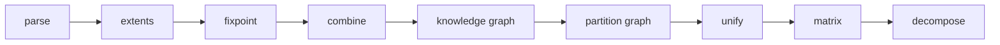
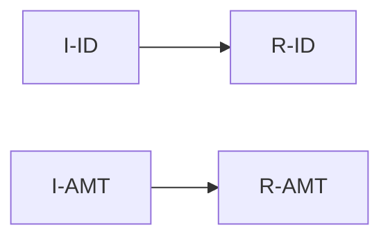

*This post is about finding the domain concepts hidden in a COBOL codebase: which fields, across thousands of programs, make up one customer, one account, one order. It follows the pipeline from the first idea to a run on a production corpus of about 3,800 programs, including every place it was too slow, too big, or quietly wrong. The detailed mechanics are in new explainers, linked as they come up.*

---

## Table of Contents

- [The question](#the-question)
- [Why names don't work](#why-names-dont-work)
- [Byte-level dataflow first](#byte-level-dataflow-first)
- [The pipeline](#the-pipeline)
- [From bytes to fields](#from-bytes-to-fields)
- [One datum, many names](#one-datum-many-names)
- [The encoding, and why NMF](#the-encoding-and-why-nmf)
- [CardDemo says yes](#carddemo-says-yes)
- [Into the production corpus](#into-the-production-corpus)
  - [Stuck on one row](#stuck-on-one-row)
  - [Maximum recursion depth exceeded](#maximum-recursion-depth-exceeded)
  - [Hours cutting dataset slots](#hours-cutting-dataset-slots)
  - [A 4.7 GB graph](#a-47-gb-graph)
  - [A 300 GB matrix](#a-300-gb-matrix)
  - [Failing at the end](#failing-at-the-end)
- [It ran, and every factor was one program](#it-ran-and-every-factor-was-one-program)
  - [Three wrong theories](#three-wrong-theories)
  - [Measuring instead](#measuring-instead)
  - [Why files didn't join](#why-files-didnt-join)
  - [What should have shown up anyway](#what-should-have-shown-up-anyway)
- [Precision as a knob](#precision-as-a-knob)
- [Measuring quality](#measuring-quality)
- [What I took from it](#what-i-took-from-it)
- [Explainers](#explainers)

---

## The question

Modernising a large COBOL estate usually starts with the data. Before you can draw service boundaries or design a schema, you need to know the concepts: which fields together make up one thing, and which code works on it.

Call such a group of fields a **domain aggregate**. A customer's name, address and status. An account's balance, limits and cycle totals. The question this pipeline answers is:

> Which fields, across every program, belong to one aggregate, and which paragraphs use it?

No one has written this down. The answer is spread across thousands of copybooks and programs, each with its own names for the same bytes.

## Why names don't work

The obvious approach is to match field names. In COBOL it fails for several reasons.

| Construct | Why names mislead |
|---|---|
| Copybooks per program | A commarea passed between two programs is laid out by each with its own copybook. The caller's `CDEMO-USER-ID` is the callee's `LK-COMMAREA(25:32)`. |
| `REDEFINES` | Two names, two shapes, one set of bytes. A write through one is a change to the other. |
| Group moves | `MOVE REC TO OUT-REC` copies every child field without naming any of them. |
| Undivided buffers | A record read into a `PIC X(500)` area, then moved into a structured record, loses its field names on the way through. |
| `FILLER` and prefixes | Thousands of `FILLER` fields, and naming conventions that differ by team and decade. |

The only thing two programs reliably agree on is the bytes. Field `A` in one program and field `B` in another are the same datum if the bytes of `A` end up, in place, in `B`.

So everything has to be done at byte granularity. The [byte-extent aliasing](/explainers/byte-extents.html) explainer shows the smallest case; the [COBOL primer](/explainers/cobol-primer.html) covers the vocabulary.

## Byte-level dataflow first

That needed a dataflow analysis that tracks bytes, not names. Building it was its own project, covered in [Adventures in Fixpoint Analysis](/2026/10/09/adventures-in-fixpoint-analysis.html). The short version:

- Every field is a byte range: region, start, end.
- A [fixpoint over the control flow graph](/explainers/fixpoints.html) works out, for every read, which writes it may see: its [reaching definitions](/explainers/reaching-definitions.html), by byte overlap.
- A combine stage links programs through the commareas they hand each other.

The output this post needs is **byte provenance**: for each statement, the source bytes, the target bytes, and the earlier statements whose writes the source may hold.

At first, provenance came from a separate stage that sampled paths through each program. Sampling had blind spots, and by then the fixpoint already computed provenance for every byte it tracked. So the pipeline switched to reading the fixpoint's output directly, and the sampler went.

## The pipeline



| Stage | Produces |
|---|---|
| parse, extents | each program's syntax tree, and every field's byte ranges |
| fixpoint, combine | byte provenance, and the links between programs |
| knowledge graph | programs, files, JCL steps, datasets |
| partition graph | a graph of elementary fields, with byte placements on every edge |
| unify | classes of fields that hold one datum across programs |
| matrix | a paragraph × field incidence matrix |
| decompose | rounds of NMF; each factor is a candidate aggregate |

## From bytes to fields

Provenance is about bytes. Aggregates are about fields. The **partition graph** turns one into the other: each node is an elementary field, `PROGRAM:RECORD.FIELD`, and each byte move becomes edges between fields.

The hard case is a copy through an undivided buffer:

```cobol
/0  MOVE IN-AREA TO BUF.    *> IN-AREA has I-ID and I-AMT; BUF is PIC X(8)
/1  MOVE BUF TO REC.        *> REC has R-ID and R-AMT
```

Mapped naively, `/1` links `BUF` to both `R-ID` and `R-AMT`, so `I-ID` looks related to `R-AMT`. Instead, the graph follows `/1`'s definer back through `BUF` to the fields that filled it:



Every edge also records **where the bytes land**: from which offset in the source field to which offset in the target. That placement is what the next stage depends on.

Files are handled the same way. A dataset's record is cut into slots at every field boundary any program uses. Writers link to slots, slots to readers.

The [field graph explainer](/explainers/field-graph.html) walks through tracing, placements and dataset slots.

## One datum, many names

**Unify** finds fields in different programs that hold one datum. The test is strict:

1. same size;
2. byte `i` of one lands on byte `i` of the other, for every `i`;
3. no byte lands anywhere else in it.

Table occurrences and dataset slots **relay**: a byte passing through `LK-COMMAREA(25)` keeps going, and only where it ends up counts. That is how a caller's `CDEMO-USER-ID` joins a callee's field through a linkage byte table.

Two more rules keep it honest:

- Copies inside one program never join.
- A field reached by any edge with no known placement neither relays nor joins.

The [exact field classes explainer](/explainers/exact-classes.html) works through a graph where each rule decides one pair.

## The encoding, and why NMF

The matrix has one row per paragraph and one column per field, with a 1 where the paragraph touches the field. Each unified class is one column, so one datum is one column across programs.

**Non-negative matrix factorisation** approximates that matrix as `W × H`, both non-negative:

- each row of `H` is a factor's **field loadings**: what the aggregate is made of;
- each column of `W` is its **paragraph loadings**: where it is used.

Why should it work? A paragraph does one job, and a job touches a few aggregates. So each row of the matrix is roughly the union of a few aggregates' fields, which is what a non-negative sum of a few factors expresses. Non-negativity matters: nothing can be subtracted, so every factor has to be a part that adds up.

An earlier version scored field *pairs* by pointwise mutual information. It dropped every field seen in fewer than three paragraphs. The incidence matrix keeps them all.

Decompose runs in **rounds**: first only the fields used in many paragraphs, then looser thresholds over what earlier rounds left unexplained. The [factorisation explainer](/explainers/nmf-aggregates.html) has the details and a worked example.

## CardDemo says yes

[CardDemo](https://github.com/aws-samples/aws-mainframe-modernization-carddemo), the open-source CICS sample, has 31 programs. With dataset links in the graph, round 1 found the account, customer, transaction, card and user records, each with the paragraphs that read or write it. The account record came out as one factor across all five programs that use it.

About a third of the factors were noise, one program's working storage each: `FILLER` runs, file-status pairs, map fields, commareas. Excluding those by name pattern left factors that were almost all real records.

So the method worked on a small, clean corpus. Then it went to production.

## Into the production corpus

The corpus: about 3,800 programs, mostly CICS online with some batch. The fixpoint and combine already ran on it, after the work in the earlier post. The new stages did not.

| Stage | First problem |
|---|---|
| partition graph | stuck on one progress line for hours |
| partition graph | `maximum recursion depth exceeded` |
| partition graph | hours in "cutting dataset slots" |
| unify | silent after its first line |
| decompose | died outright |
| several | crashed at the end, writing output |

None of these showed up on CardDemo. It is 1% of the size.

### Stuck on one row

The partition graph logs a line every 1,000 dep rows. It stopped logging.

Tracing a read back through copies is a walk over definers, and definers branch. The walk was memoised, but the memo key included the set of sites already on the walk, to cut loops. That set is different on every path. So the memo almost never hit, and the walk enumerated **paths** instead of copies.

| Ladder of two-way copies | Paths | Copies |
|---|---|---|
| n steps | 2ⁿ | 2n |
| measured at n = 18 | 5.5 s, doubling per step | |

The fix keyed the memo on the range and its definers alone. Acyclic copies give identical answers. Inside a loop of copies, the first read to reach a range fixes its answer, which is a documented approximation. CardDemo's graph stayed byte-identical.

### Maximum recursion depth exceeded

The next corpus run crashed. The walk recursed about eight Python frames per copy, and a chain of about 130 copies is enough to hit the limit. Real programs have chains like that: a record moved through a sequence of work areas.

I first tried replacing the walk with a fixpoint over strongly connected components. It oscillated: one rule in the walk ("take the finer pieces only if there are two or more") is not monotone, so iterating never settled. A version without that rule settled, but gave wrong edges on CardDemo.

So the walk stayed exactly as it was, moved onto an explicit stack. Each lookup became a generator that yields the lookups it needs. Same order, same memo, same answers, and no depth limit.

### Hours cutting dataset slots

Linking dataset slots read a property, `graph.barrier`, once per dataset edge. The property scans every edge in the graph. So the step cost dataset edges × graph edges: on CardDemo half a second, on the corpus about an hour. Reading it once fixed it.

### A 4.7 GB graph

The graph file came out at 4.7 GB: 18.9 million lines, nearly 4 million field nodes. Unify then sat silent after its first log line.

It wasn't stuck. It was reading the file into full Pydantic models, and swapping.

| Reader | Memory per MB of file | Projected for 4.7 GB |
|---|---|---|
| full models | 7.8× | about 37 GB |
| slim, streamed, interned ids | 3.3× | about 15 GB |

The new reader parses each line into a small record with only the fields unify uses, and logs progress every tenth of the file. The classes it produces are identical.

### A 300 GB matrix

The matrix: 65,327 paragraphs × 592,104 fields, with 4.5 million non-zeros. Decompose died at once.

Its first line turned the sparse matrix into a dense one: about 300 GB of doubles. Each round then made several more copies of the same size.

The fix rests on one observation. Each round factors `max(0, X − rebuilt)`, and `rebuilt` is never negative, because the factors aren't. So wherever `X` is 0, the residual is 0 too:

> The residual is non-zero only where the matrix already is.

So each round computes the rebuild only at the matrix's non-zeros, and keeps only the factors, never their product. The factors on CardDemo came out identical.

| Matrix | Before | After |
|---|---|---|
| 3,000 × 20,000, 120k non-zeros | 5.9 GB | 155 MB |
| 100,000 × 600,000, 4.5M non-zeros | about 480 GB | 1.2 GB, 50 s |

### Failing at the end

None of the stages created their output directory. A missing directory meant losing an hour of computation at the final write. They all create it now.

## It ran, and every factor was one program

With all of that fixed, the pipeline ran end to end. Decompose produced 36 factors over three rounds.

Every one of them was a single program's commarea. No factor crossed programs, and none split a program into smaller concepts.

### Three wrong theories

An AI agent analysing the outputs offered three root causes in a row. Each sounded plausible, and each was wrong:

| Theory | Why it was wrong |
|---|---|
| Stages name programs differently (file name versus `PROGRAM-ID`) | True in the code, but only 3 of 3,000+ programs differ |
| The matrix only includes fields that are written, not read | The matrix is built from the fixpoint's reads; on CardDemo a quarter of those reads have no writer at all |
| File records never unify, because they don't pass through a `MOVE` | Unify already relays through dataset slots; that is how CardDemo's account record joined |

The lesson was the same each time: a theory about a big corpus needs a number from that corpus.

### Measuring instead

So I added a diagnostic, `class-share`. For each threshold, it counts how much of the matrix sits in unified-class columns, the only columns that carry cross-program evidence:

| Threshold | Corpus: columns | Class columns | Class share | CardDemo class share |
|---|---|---|---|---|
| 10 | 97,756 | 2,627 | **3.8%** | 33.8% |
| 5 | 160,038 | 3,340 | **3.5%** | 19.2% |
| 2 | 433,755 | 5,091 | **3.1%** | 15.0% |

More than 96% of what NMF sees belongs to a single program. To NMF, the matrix is nearly one block per program.

### Why files didn't join

The diagnostic then read the graph and counted the dataset links:

| | Corpus | CardDemo |
|---|---|---|
| dataset slots | 92,999 | 263 |
| `exact` dataset edges | 152,137 (8%) | 653 (65%) |
| `possible` dataset edges | 1,854,046 (92%) | 350 |
| fields linked only by `possible` edges | 1,075,617 | 100 |

A `possible` edge carries no byte placement, so unify can't use it. Broken down by reason:

| Reason | Edges |
|---|---|
| `unresolved-file` | 1,759,917 |
| `overlapping-layouts` | 116,968 |
| `dd-unbound` | 40,555 |
| `candidates` | 36,700 |
| `no-step` | 10,820 |

95% are `unresolved-file`: file statements the pipeline could not tie to any dataset name at all. The corpus has no real CSD, but that turned out not to matter. Without a CSD entry the CICS file name itself serves as the dataset's identity. What was missing came earlier: the combine stage had no file target for those statements. A third diagnostic, `file-sites`, now sorts every unresolved statement by which lookup missed.

### What should have shown up anyway

Then the important correction: dataset joins are the best case, not something to expect. Many estates won't have the metadata to tie every file statement to a dataset. But even with no cross-program joins at all, NMF should still find **groupings inside programs**. It found none.

That one comes from the factorisation, not the data. With 3,764 programs, a nearly block-diagonal matrix and `k` of 8 to 16, each factor goes to the biggest remaining block: one large program's most-touched fields. Those are its commarea fields, which nearly every paragraph touches. Thirty-six factors cannot get below one program each.

Two things follow:

- **Hub fields have to go.** Commarea fields every paragraph touches are noise for this question. The matrix stage takes `--exclude` patterns for that. Testing them showed a catch: a pattern only sees the record and the field's own name, not the groups in between.
- **One global fit is the wrong shape.** Factoring each program, or each connected group of programs, with its own `k` is the next step.

## Precision as a knob

Unify's rules are strict on purpose, and on a messy corpus strict means sparse. Which ones can be loosened without losing much precision? I measured each one on its own, on CardDemo:

| Loosened rule | Classes | Fields | What it added |
|---|---|---|---|
| none (baseline) | 90 | 394 | |
| ignore edges with no placement | 92 | 448 | 54 fields, all correct in the samples I checked |
| allow joins inside one program | 434 | 1,727 | real copies, but also 42 fields set from one value merged into one class |
| accept 75% of bytes in place | 90 | 394 | nothing |
| join a field to a bigger one containing it | 45 | 438 | collapse: chains merged distinct fields |

Only the first is cheap, and it is now `--join-unplaced`. The second could work with a fan-out guard. The last two stay off.

## Measuring quality

How do you show a factorisation is any good, with no labelled answer? The `scorecard` stage reports a headline and seven sub-scores, each on a different axis:

| Score | Planted blocks | CardDemo round 1 | Random matrix |
|---|---|---|---|
| **held-out AUC** | 1.000 | 0.973 | 0.49 |
| fidelity (relative error) | 0.000 | 0.310 | 0.999 |
| coverage | 100% | 70.4% | 0.4% |
| stability over resampling | 1.000 | 0.955 | 0.575 |
| distinctness (largest cosine) | 0.000 | 0.553 | 0.049 |
| focus | 1.000 | 1.000 | 0.343 |
| cross-program reach | 50% | 76.7% | n/a |
| class share | 10% | 19.2% | 0% |

The headline hides 10% of the matrix's 1s, fits on the rest, and asks how often a hidden 1 outranks an empty cell. It has a catch, which a reviewing agent spotted. On a matrix that is 99.99% empty and nearly block-diagonal, a random empty cell is almost always in another program, which is an easy call. Until the empty cells are drawn from the same program, the AUC has to be read next to coverage and reach.

The [scoring explainer](/explainers/scoring-factorisations.html) defines each score and how to read them together.

## What I took from it

- **Precision upstream is what makes this possible.** Byte provenance, byte placements and strict classes are why CardDemo's factors were real records rather than name clusters.
- **Small corpora hide every scaling problem.** CardDemo confirmed correctness at every step and revealed none of the six performance problems.
- **An exact rewrite often exists.** The sparse residual, the explicit-stack walk and the barrier fix all changed nothing in the output. Look for the reformulation before reaching for an approximation.
- **Measure before theorising.** Three plausible root causes fell to three numbers. A diagnostic stage is cheaper than a wrong fix.
- **Strictness is a dial.** Measure each rule's recall against its precision, and expose only the ones that are cheap.
- **Check the metric's blind spots.** A headline number on a sparse, blocky matrix can look good for the wrong reason.

## Explainers

| Explainer | Covers |
|---|---|
| [From byte provenance to a field graph](/explainers/field-graph.html) | elementary fields, tracing back through undivided buffers, byte placements, dataset slots, memo and stack |
| [Exact field classes across programs](/explainers/exact-classes.html) | the byte-in-place test, relays, the unplaced rule, each loosening measured |
| [Domain aggregates by matrix factorisation](/explainers/nmf-aggregates.html) | the encoding, NMF, why it should work, rounds, the sparse residual |
| [Scoring a factorisation](/explainers/scoring-factorisations.html) | held-out AUC and seven sub-scores, and where the headline flatters |

The [earlier explainers](/explainers/index.html) cover the dataflow these build on: traversal orders, fixpoints, reaching definitions, byte extents and value sets.
