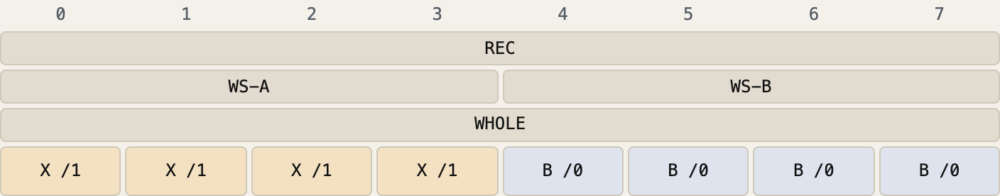
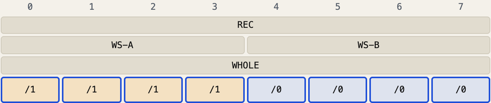
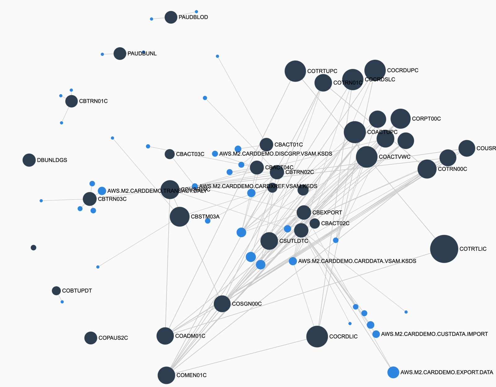
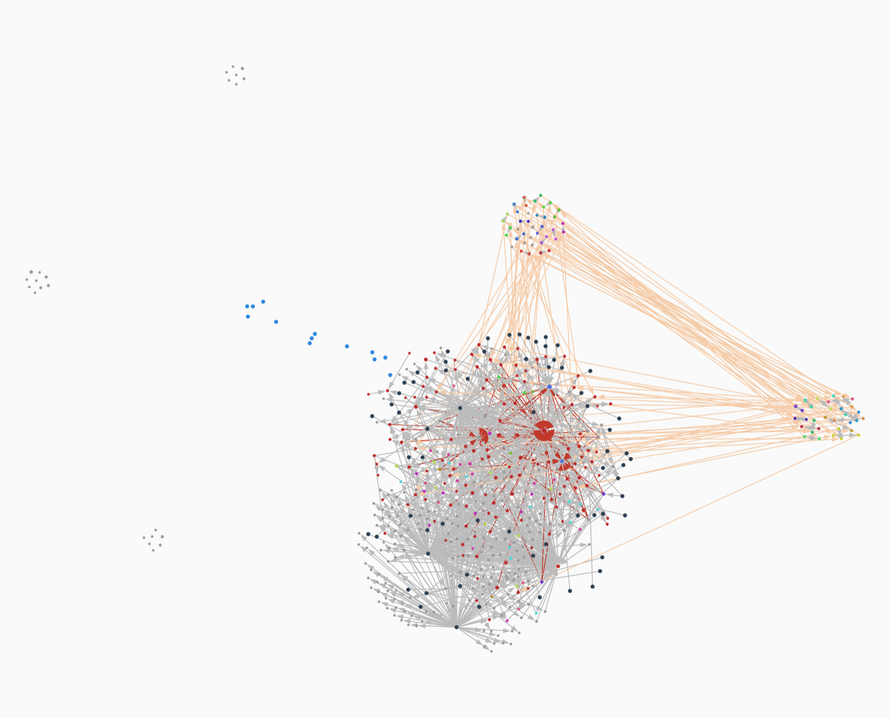
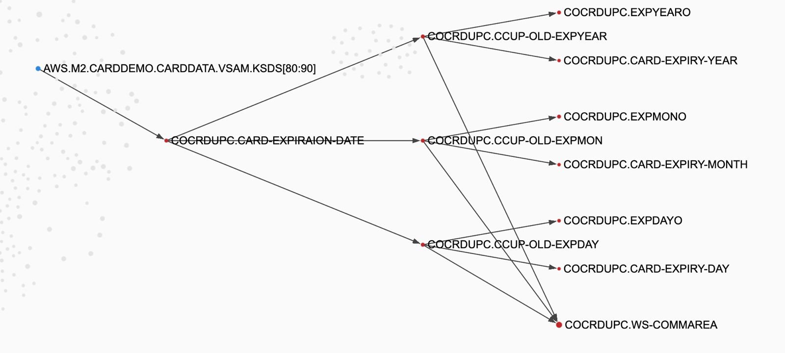

*This post explains non-negative matrix factorisation (NMF), and how cobble uses it to find domain aggregates in a COBOL codebase. A domain aggregate is a group of fields that belong to one thing, such as one account or one customer. The post uses one run on CardDemo, the public CICS sample application. It shows the matrix, the factors that the run found, and the scores that say how good they are. It then follows the same pipeline on a production corpus of about 3,800 programs: what broke at that size, and what the factorisation found.*

---

## Table of Contents

- [Why look for aggregates](#why-look-for-aggregates)
- [What we hope to find](#what-we-hope-to-find)
- [Ye Olde Linear Algebra](#ye-olde-linear-algebra)
- [What NMF does](#what-nmf-does)
- [A small example](#a-small-example)
- [Bytes and Names](#bytes-and-names)
  - [Why names fail in COBOL](#why-names-fail-in-cobol)
  - [What the bytes give the matrix](#what-the-bytes-give-the-matrix)
- [The CardDemo matrix](#the-carddemo-matrix)
- [Rounds](#rounds)
- [What round 1 found](#what-round-1-found)
  - [Account](#account)
  - [Card cross-reference](#card-cross-reference)
  - [Transaction](#transaction)
  - [Card](#card)
  - [Customer](#customer)
  - [User](#user)
  - [Transaction-category balance](#transaction-category-balance)
  - [Session, split in two](#session-split-in-two)
  - [Records inside one program](#records-inside-one-program)
  - [What is left: hubs](#what-is-left-hubs)
- [What round 2 found](#what-round-2-found)
- [The scores](#the-scores)
- [Into a production corpus](#into-a-production-corpus)
  - [Making it run](#making-it-run)
  - [The final run](#the-final-run)
- [What I took from it](#what-i-took-from-it)

---

## Why look for aggregates

One of the common things to do when modernising a system (or building it from scratch) is to figure out the domain. This is essentially the world model of the system, exact enough to replicate the process that needs to happen to get a business get its work done. There are several ways of teasing this out, but there are always some underlying things that emerge regardless of the process followed. One of those things is the domain objects. domain objects encapsulate both behaviour and data; how that is represented depends upon how the process models them.

As an example, there is an exercise called event storming; it is a collaborative process for extracting a set of entities:
- Domain aggregates
- Commands
- Events
- Policies

The **Domain Aggregates** are the closest to what would come to mind when talking about a domain model, though they aren't 1:1 mappings. Aggregates are clusters of domain objects which form a natural boundary; this boundary is usually meant to be an abstraction boundary, expressed as an interface, transaction, etc. Before we get to domain aggregates, however, we need to conceptualise the domain objects themselves.

What constitutes a domain object?

If you are in the room with an SME in a particular domain, the answer may be obvious. Alternatively, literature on specific domains may provide clear concepts which can be mapped to these objects without too much headache. One of the common issues in legacy modernisation is that, oftentimes, even though the code may be available, SMEs and documentation are not. This may or may not be a blocker depending upon how the system has been designed / written. Languages that have been written with data aggregation in mind, may expose models which naturally express the domain, eg: classes, structures, etc. in Java, C#, etc. (though this is not a guarantee, transpiled Java code from legacy languages can be *more* unreadable than the original legacy code). In this post, I will use COBOL as an example of where the domain objects aren't naturally expressed in the data structures, and talk of using a simple, well-known technique from Linear Algebra to extract out clusters of fields which are potential candidates for domain objects.

We thus return to the previous question, but rephrase it:

_What constitutes a domain object, given there is no documentation and no SME?_

There may be many answers to this question, and in the mind of a domain expert, there will usually be one or two, depending upon the domain / subdomain and the context. Absent such information, we'd still like to build some sort of a fitness function which can at least approximate what these domain objects would look like, even if we cannot name them immediately. The characterisation I find useful is that the domain objects are things whose constituent data / fields have a high degree of co-occurrence. If you know that two pieces of data are used together a lot, whether it is reading or writing, there is a **higher probability** that they belong together in the same domain. Note again that this is not an immutable rule; a logging object used whenever an account is updated, co-occurs with accounts a lot, but that doesn't imply it is part of the same domain object. But it is a useful heuristic, which can give us potential candidates which can then be sliced and / or aggregated further: that's where LLMs come into the loop of naming, slicing, and dicing.

In an object-oriented system, the classes give this first answer. A COBOL codebase has no classes. The nearest thing is the copybook. It is a weak guide, for three reasons:

- **Copies change names.** Each program copies a record into its own storage, often under other names. COTRN02C's `CDEMO-CT02-TRN-SELECTED` holds a card number. Because of the memory-addressable renaming capability of REDEFINEs, names as the sole distinguishing factor can frequently be a poor guide. Applied naively, different names operating on the same data ends up fragmenting any inference of the domain object model.
- **One record can hold several things.** A commarea carries the user, the customer, the account, the card and the screen navigation, all together.
- **Working storage holds part-copies.** A program keeps a few fields of a record, such as the "old" values on an update screen, under its own names.

So the question "what are the domain entities of this system?" has no immediate direct answer in the code. It has an indirect answer in how the code uses data. A paragraph does one job. A job reads or writes the fields of one or a few entities. So fields that the same paragraphs use, across many programs, probably belong to one entity.

## What we hope to find

Technically, you can use LLMs to go through your entire codebase, and fish out candidates. There are a few points to think about, though:

- LLMs need to reason through the aliasing of memory regions across programs. This might not the biggest problem if you are using more advanced models, but much of my current work focuses on allowing less stronger models to do better inference.
- Contexts are huge in legacy codebases. Reasoning across all this costs tokens. There is definitely scope to do a lot of cheap deterministic analysis before bringing in models of any kind.
- The outcome is neither determministic, nor traceable; there may be skips.

For this to be useful, we expect to get a few things:

1. **The entities.** Each entity is a group of fields, joined across programs, whatever names each program gives them. Names which partially or fully refer to the same memory region(s) should have clear correlations.
2. **Where each entity is used.** For each entity, the paragraphs that read or write it. These are the candidate owners of the entity, and the places that a change to it affects.
3. **Which entities cross the batch and online boundary.** A record that both a nightly batch job and a CICS screen change is a place where a modernised system needs one owner.
4. **Shared state that is not an entity.** Session data that programs pass to each other, such as the commarea, also shows up as a group. It is not part of the domain model. It tells you which programs form one user-facing flow.

There are other things that may surface, but the idea is to be able to extract out useful clusters of co-occurring data, _cheaply_, for more expensive analyses to happen downstream.

## Ye Olde Linear Algebra

Remember the classic Netflix recommender system idea? Users rate a bunch of movies they have watched, and the recommender system can usually unearth both the genre and the taste of each user. Let's refresh that idea really quick.

Put the ratings in a matrix, with one row per user and one column per movie:

| User | *Alien* | *Aliens* | *Notting Hill* | *Love Actually* |
|---|---|---|---|---|
| Asha | 5 | 4 | 0 | 1 |
| Ben | 4 | 5 | 1 | 0 |
| Chen | 0 | 1 | 5 | 4 |
| Dana | 4 | 4 | 4 | 5 |

The columns could be independent, but in the real world, they are not: people who like *Alien* also like *Aliens*. The recommender writes the matrix as the product of two decomposed matrices:

- **A movie-by-factor matrix.** Each factor is a column pattern. One factor loads on *Alien* and *Aliens*, and another factor loads on the two romantic comedies. We call the first "science fiction" and the second "romance", but the fit only gives the numbers. The names are ours.
- **A user-by-factor matrix.** Each row gives one user's taste as a mix of the factors. Asha and Ben are mostly science fiction, Chen is mostly romance, and Dana likes both.

The product of the two matrices also fills the cells that a user did not rate. That fill is the recommendation.

Now replace users with paragraphs, and movies with fields. A "rating" is 1 when the paragraph reads or writes the field. The factors are then column patterns of fields that the same paragraphs use: candidate entities. The other matrix gives, for each paragraph, its mix of entities. Dana is the paragraph that shows an account and its customer together.

The rough correspondence is shown below.

| Netflix | CardDemo |
|---|---|
| user | paragraph |
| movie | field |
| rating | the paragraph touches the field |
| genre (factor) | candidate entity |
| a user's taste | the entities a paragraph uses |
| recommending an unseen movie | predicting a field a paragraph does not touch |

One difference here is that the factorisations from the Netflix Prize allowed negative numbers. The variant this experiment does not, because either a paragraph either uses a field, or it does not; there is no "negative use" of a field in a paragraph.

Thus, three properties of the problem lead to NMF:

- **A paragraph uses several entities at once.** A paragraph that shows an account also shows its customer. A clustering that puts each paragraph in one group cannot express that. NMF writes each paragraph's row as a sum of several factors.
- **The data is counts, not signs.** A paragraph either touches a field or it does not. There is no "negative use". NMF keeps every loading at zero or more, so a factor is always something that is present.
- **We want both halves.** One fit gives what each factor is made of, and where each factor is used. Both are needed: the first is the entity, and the second is its owners.

## What NMF does

Take a matrix `X` with one row per paragraph and one column per field. An entry is 1 when the paragraph reads or writes the field, and 0 otherwise.

NMF approximates `X` as the product of two smaller matrices, `W × H`:

- `H` has one row per **factor**. A row gives each field a loading: how much the field belongs to the factor. This is what the aggregate is made of.
- `W` has one column per factor. A column gives each paragraph a loading: how much the paragraph uses the factor. This is where the aggregate is used.

You choose the number of factors, `k`. Every entry of `W` and `H` must be zero or more. The fit finds the `W` and `H` that make `W × H` as close to `X` as it can, in squared error. cobble uses scikit-learn's `NMF` with the `nndsvda` start.

Mathematically:

$$
X_{n \times m} \approx W_{n \times k} \times H_{k \times m}
$$

## A small example

Here are four paragraphs and five fields:

| Paragraph | `ACCT-ID` | `ACCT-BAL` | `CUST-ID` | `CUST-NAME` | `WS-MSG` |
|---|---|---|---|---|---|
| `READ-ACCOUNT` | 1 | 1 | 0 | 0 | 0 |
| `UPDATE-BALANCE` | 1 | 1 | 0 | 0 | 1 |
| `READ-CUSTOMER` | 0 | 0 | 1 | 1 | 0 |
| `SHOW-ACCOUNT` | 1 | 1 | 1 | 1 | 0 |

With `k = 2`, scikit-learn gives this `H`:

| Factor | `ACCT-ID` | `ACCT-BAL` | `CUST-ID` | `CUST-NAME` | `WS-MSG` |
|---|---|---|---|---|---|
| 0 | 1.50 | 1.50 | 0 | 0 | 0.58 |
| 1 | 0.09 | 0.09 | 1.30 | 1.30 | 0 |

And this `W`:

| Paragraph | Factor 0 | Factor 1 |
|---|---|---|
| `READ-ACCOUNT` | 0.62 | 0 |
| `UPDATE-BALANCE` | 0.74 | 0 |
| `READ-CUSTOMER` | 0 | 0.76 |
| `SHOW-ACCOUNT` | 0.58 | 0.77 |

Factor 0 is the account and factor 1 is the customer. `SHOW-ACCOUNT` uses both, so it loads on both. `WS-MSG` appears in only one paragraph, so factor 0 takes part of it. The fit is not exact: the product puts 0.36 where `READ-ACCOUNT` has a 0 for `WS-MSG`. With real data, the fit is never exact.

## Bytes and Names

The matrix is only as good as its answer to "does this paragraph touch this field?", and to "are these two columns the same datum?". In COBOL, names answer neither question well. Bytes answer both. The matrix stands on cobble's byte-level dataflow, which the [earlier post on fixpoint analysis](/2026/10/09/adventures-in-fixpoint-analysis.html) describes.

### Why names fail in COBOL

COBOL storage is a sequence of bytes, and a field name is a label on a range of those bytes. Several features of the language put more than one label on the same bytes, or move bytes with no regard to labels.

A small program shows the idea. `REC` is eight bytes. `WS-A` is its first four and `WS-B` its last four. `WHOLE` redefines all eight:

```cobol
/0  MOVE 'AAAABBBB' TO REC.
/1  MOVE 'XXXX' TO WS-A.
```

{: width="640"}

*The four rows of names are labels on the same eight bytes. Each cell shows its final character and the statement that last wrote it. Statement 0 wrote `WS-B` without naming it. Neither statement names `WHOLE`, but both wrote its bytes. From the [byte extents explainer](/explainers/byte-extents.html).*

The features that cause this:

- **`REDEFINES`.** Two fields with different names, and often different pictures, share the same bytes. A write to one is a write to the other.
- **Group moves.** A move such as `MOVE ACCOUNT-RECORD TO WS-ACCOUNT` copies every byte of the record. No elementary field is named, but every one of them moves.
- **Undivided buffers.** A record read into a `PIC X(500)` area, then moved into a structured record, loses its field names on the way through.
- **Reference modification.** A statement can move a part of a field by position. Card update fills its "old" expiry year like this:

  ```cobol
  MOVE CARD-EXPIRAION-DATE(1:4)    TO CCUP-OLD-EXPYEAR
  ```

  The names say nothing about each other. The bytes say that `CCUP-OLD-EXPYEAR` holds bytes 1 to 4 of the expiry date.
- **Commareas and files.** Programs pass data to each other as a block of bytes. Thirteen CardDemo programs take in their commarea with `MOVE DFHCOMMAREA(1:EIBCALEN) TO CARDDEMO-COMMAREA`. The receiving program lays its own names over those bytes. A file record works the same way: each program that reads the file has its own layout, with its own names, over the same record.

So the same datum has many names, and one name can mean different data in different programs. An analysis that follows names joins things that are different, and splits things that are the same.

### What the bytes give the matrix

Two steps use the byte-level dataflow before NMF runs:

1. **Touches are byte ranges.** For each write, the fixpoint records the bytes it lands on, and the paragraphs where it happens. A touch is then every elementary field whose bytes overlap that range. A group move touches every field inside the group. A write through a `REDEFINES` touches the fields that share its bytes. In the small program above, a read of `WHOLE` overlaps all eight bytes, so it depends on both statements:

   {: width="640"}

   *The outlined cells are the bytes the read covers. Their writers are statements 0 and 1. A match by name finds no writer at all.*
2. **Copies become one column.** If an exact chain of moves carries a field's bytes, unchanged, into another field, the two fields are one *class*. The chain can cross programs, through commareas and files. Each class is one column. CardDemo has 108 classes. The largest is `XREF-CARD-NUM`, the card number in the card cross-reference record, which is one class across 10 programs. The [field graph explainer](/explainers/field-graph.html) shows how byte moves become edges between fields, and the [exact field classes explainer](/explainers/exact-classes.html) shows the test that joins two fields into one class.

Without step 2, each of the seven programs that hold the account record would have its own account columns. Nothing in the matrix would join them. Each factor could then only group one program's fields. I did not run that comparison. With step 2, the fit found one account factor with strong users in six programs. Every cross-program factor below rests on such classes.

The byte-level dataflow of this run, drawn as cobble's program map:

{: width="640"}

*Dark dots are programs, sized by their number of graph nodes. Blue dots are dataset records. An edge means the byte-level graph has edges between the two, and it is thicker for more edges. The map has 38 programs, 38 datasets and 110 links. The dense cluster on the right holds the online card, account and transaction screens, and the sign-on and menus. It also holds the batch programs that share their files, such as the card and cross-reference files. The programs on the left have few links to the rest, and most of them are batch.*

Inside one program, the graph is fields joined by byte moves. This is card update, `COCRDUPC`:

{: width="640"}

*Each dot is a field, and each edge is a byte move from one field to another. Grey edges join fields within card update. Pale orange edges cross to another program. The two groups at the top and on the right are fields of the card list (`COCRDLIC`) and the menu (`COMEN01C`). Both exchange the commarea with card update. Red edges come from statements that the partition's fan-out barrier blocks. Such a statement links one field to more than 8 others, as when a program saves a commarea whole. Blue dots are dataset slots. The page reports 45 components and 227 isolated fields. The largest component has 130 fields, from the commareas: `DFHCOMMAREA`, `WS-THIS-PROGCOMMAREA` and `CARDDEMO-COMMAREA`.*

Zoomed in, the edges are byte moves between named fields. Here is the card's expiry date, from the card file to the screen:

{: width="640"}

*The read of the card file puts bytes 80 to 90 of the record into `CARD-EXPIRAION-DATE`. Card update then splits the date by position: bytes 0 to 3 go to `CCUP-OLD-EXPYEAR`, 5 and 6 to `CCUP-OLD-EXPMON`, and 8 and 9 to `CCUP-OLD-EXPDAY`. Each part then goes to a screen output field (`EXPYEARO` and so on), to a working-storage field, and into the saved commarea `WS-COMMAREA`. No name links `CARD-EXPIRAION-DATE` to `CCUP-OLD-EXPYEAR`. The bytes do. I picked these twelve nodes and dragged them into columns. The page has other neighbours of these fields, such as literal moves and the incoming commarea bytes, which I left out.*

The above byte level dataflows require running a set of COBOL-specific static analyses. Some of these are:

- Byte extent extraction from copybooks
- Interprocedural fixpoint analysis of dataflow

These analysis tools are present in [RedDragonForge](https://github.com/avishek-sen-gupta/red-dragon-forge).

## The CardDemo matrix

The statistics for the CardDemo imply that we factor a matrix of size $$454 \times 1885$$.

| | CardDemo |
|---|---|
| programs | 38 |
| paragraphs (rows) | 454 |
| fields (columns) | 1,885 |
| entries that are 1 | 4,661 |
| classes | 108 |

Most fields are rare. 927 fields appear in only one paragraph, and only 429 appear in four or more.

## Rounds

A factor needs evidence. A field that only one paragraph touches cannot show which other fields go with it. So the fit runs in rounds:

1. **Round 1** keeps the fields that appear in at least four paragraphs. That is 429 columns. It fits `k = 30`.
2. **Round 2** keeps the fields that appear in at least two paragraphs. That is 958 columns. It fits `k = 10` to what round 1 did not explain. Round 1's factors already explained 54% of round 2's matrix.

Each fit took under a second. Round 1 ran 51 iterations and round 2 ran 16.
Each extracted group was then passed to an LLM for naming an appropriate domain object. The sections which follow describe the groupings and the names that were assigned to those groups.

## What round 1 found

A factor's `W` column says which paragraphs use it. Nine of round 1's 30 factors have strong users, with a loading above 0.1, in more than one program. Seven of the nine are entities, and two are the session. Four more factors are records seen through one program. The rest are noise. This section reads each interesting factor in turn.

### Account

**Factor 4. Strong users in six programs:** `CBACT01C`, `CBACT04C`, `CBEXPORT`, `CBTRN02C`, `COACTUPC`, `COACTVWC`.

Its top fields are all `ACCOUNT-RECORD` fields, with loadings from 0.87 to 1.25:

- `ACCT-CASH-CREDIT-LIMIT`, `ACCT-CREDIT-LIMIT`, `ACCT-ACTIVE-STATUS`
- `ACCT-GROUP-ID`, `ACCT-REISSUE-DATE`, `ACCT-OPEN-DATE`
- `ACCT-ID`, `ACCT-CURR-CYC-CREDIT`, `ACCT-CURR-CYC-DEBIT`

Its top paragraphs:

| Program | Paragraph | Loading |
|---|---|---|
| `CBACT04C` | `1050-UPDATE-ACCOUNT` | 0.91 |
| `CBTRN02C` | `2800-UPDATE-ACCOUNT-REC` | 0.91 |
| `CBTRN02C` | `1500-B-LOOKUP-ACCT` | 0.90 |
| `CBEXPORT` | `3100-READ-ACCOUNT-RECORD` | 0.88 |
| `COACTUPC` | `9300-GETACCTDATA-BYACCT` | 0.83 |

**Reading:** the account is the entity that both sides of the system change. The interest calculation (`CBACT04C`) and the transaction posting (`CBTRN02C`) update it in batch. The account update screen (`COACTUPC`) changes it online. That makes the account the first place where a modernised system needs one clear owner. No name told the fit that these fields are one record. The columns are classes, and the paragraphs that use them are the only evidence.

### Card cross-reference

**Factor 24. Strong users in six programs:** bill pay, transaction add, account view, account update, the interest calculation and the export.

Its strongest field is `XREF-CARD-NUM`, at 1.81, with `XREF-ACCT-ID` and `XREF-CUST-ID`. Its paragraphs are lookups:

- `READ-CXACAIX-FILE` in bill pay and in transaction add
- `9200-GETCARDXREF-BYACCT` in account view and account update
- `1110-GET-XREF-DATA` in the interest calculation

**Reading:** this is not an entity of its own. It is the relationship between card, account and customer. Every operation that starts from one of them uses it to find the others. A modernised system would make it a relationship in the data model, not a service. The factor also pulls in the screen messages of bill pay and transaction add. Those paragraphs report a failed lookup on the screen.

### Transaction

**Factor 7. Strong users in five programs:** transaction list (`COTRN00C`), transaction view (`COTRN01C`), transaction add (`COTRN02C`), bill pay and the export.

Its top fields are the whole `TRAN-RECORD`: amount, timestamps, description, card number, type, category, source and the merchant fields.

**Reading:** this is the transaction as the online user sees it. The view program reads it, and the list program pages through it. The add program reads the last transaction for two reasons. It numbers the new transaction as the last id plus one. It also has a "copy last transaction" action, `COPY-LAST-TRAN-DATA`, which fills the screen from the last transaction.

### Card

**Factor 15. Strong users in four programs:** card view (`COCRDSLC`), card update (`COCRDUPC`), card list (`COCRDLIC`) and the export.

Its top fields are the `CARD-RECORD` fields: active status, expiry date, CVV, embossed name, card number and account id.

**Reading:** the card belongs to the three card screens. Card update reads it, checks it for changes (`9300-CHECK-CHANGE-IN-REC`) and writes it (`9200-WRITE-PROCESSING`). Card view and card list only read it. No batch program changes it in this factor.

### Customer

**Factor 5. Strong users in three programs:** account view, account update and the export.

Its ten top fields all have the same loading, 0.747: id, names, SSN, phone numbers, government id, FICO score and the primary-cardholder flag. The same six paragraphs use all of them. Below those six, the next paragraph loads at 0.008.

**Reading:** the customer is seen through the account. The paragraphs that use it are `9400-GETCUSTDATA-BYCUST` in account view and account update, and the export's read. No screen in this factor works on a customer alone. So in this run, the customer looks like part of the account's aggregate, not an aggregate of its own.

### User

**Factor 17. Strong users in five programs:** sign-on (`COSGN00C`) and the four user-administration programs, `COUSR00C` to `COUSR03C`.

Its top fields are the `SEC-USER-DATA` fields: user id, user type, first name and last name. Its paragraphs are the full set of operations on a user: list (`READNEXT-USER-SEC-FILE`), add (`WRITE-USER-SEC-FILE`), update (`UPDATE-USER-SEC-FILE`), delete (`DELETE-USER-SEC-FILE`), and the sign-on read.

**Reading:** the user is a separate area of the system. It shares no factor with the card business. It is the cleanest candidate for a separate service.

### Transaction-category balance

**Factor 22. Strong users in two batch programs:** the transaction posting (`CBTRN02C`) and the interest calculation (`CBACT04C`).

Its top fields are the category-balance record's key and balance (`FD-TRANCAT-ACCT-ID`, `FD-TRANCAT-TYPE-CD`, `FD-TRANCAT-CD`, `TRAN-CAT-BAL`), with the daily transaction's type, category and amount.

**Reading:** this is a running balance per account, per transaction type and per category. The posting program creates and updates it (`2700-A-CREATE-TCATBAL-REC`, `2700-B-UPDATE-TCATBAL-REC`) from each daily transaction. The interest calculation reads it (`1000-TCATBALF-GET-NEXT`) and computes interest from it. So it is the hand-off between two batch jobs, and their run order matters.

### Session, split in two

**Factors 20 and 18** are both the shared `CARDDEMO-COMMAREA`. It holds the user's id and type, the customer's id and names, the account's id and status, and the card number. It also holds the from-program and to-program fields for navigation.

- **Factor 20** is used by card list, card view and card update.
- **Factor 18** is used by the two Db2 transaction-type programs, `COTRTLIC` and `COTRTUPC`.

Their paragraphs are `0000-MAIN` and `COMMON-RETURN`: where each program takes the commarea in, and where it hands the commarea on.

**Reading:** this is not a domain entity. It is the session. The useful part is the split. The same record became two factors, one for each family of programs that pass it among themselves. The factorisation found two user-facing flows without being told about navigation.

### Records inside one program

Four factors are records, but only one program uses them strongly:

- **Factor 3: card update's before-image.** The `CCUP-OLD-*` fields hold the card as the screen showed it. Before it writes, `9300-CHECK-CHANGE-IN-REC` compares the card it reads again for update with these fields. If they differ, the program does not write. It refreshes the old values and reports that the data changed. This is an optimistic lock: it stops an update from overwriting a change that someone else made in the meantime.
- **Factor 8: card list's paging state.** The first and last card number on the page, the screen number and the next-page flag. The program keeps them in its commarea between tasks so that it can page forward and back.
- **Factor 27: the statement's transactions.** The statement program, `CBSTM03A`, reads transactions and writes them into the statement.
- **Factor 28: the daily transaction and its rejects.** The posting program reads each daily transaction, looks up the card and account, and writes a reject with a reason (`2500-WRITE-REJECT-REC`) when validation fails.

These are business mechanisms, not entities: a lock, a paging cursor, a report, a validation step. However, they do show up in the matrix factorisation, implying that these are useful groupings, even if they are not business domain objects themselves

### What is left: hubs

The other 17 factors are *hubs*: one program's own working storage, used by a few of that program's paragraphs. Examples:

- **Factor 2** is a run of `FILLER` fields in account update's commarea, `FILLER_200` to `FILLER_207`.
- **Factor 9** is account update's date-edit variables.
- **Factor 12** is the SQL communication area and messages of one Db2 program, `COTRTLIC`.
- **Factor 21** is the file-status fields of the account file reader, `CBACT01C`.

A hub is compact and stable. It is a real pattern in the data, but is not a domain concept.

## What round 2 found

Round 2 found less. All ten of its factors have strong users in one program only. Some of them are screens:

- Factor 0 is the transaction list screen's rows, `TRNID01I` to `TRNID10I`.
- Factor 1 is the user list screen's rows.

Others are records seen in fewer paragraphs, such as the export record in `CBIMPORT` and the customer record in the statement program, `CBSTM03A`. Others are again hubs: response codes and `FILLER`s in account view and account update.

## The scores

cobble's scorecard measures each round from several sides.

| Score | Round 1 | Round 2 | What it measures |
|---|---|---|---|
| held-out AUC | **0.851** | 0.533 | how well the factors predict hidden 1s |
| relative error | 0.421 | 0.840 | fit error divided by the matrix's size |
| coverage | 77.6% | 17.7% | 1s inside some factor's top fields and top paragraphs |
| stability | 0.963 | 0.910 | how closely refits on 90% of the rows match |
| distinctness | 0.654 | 0.032 | the largest similarity between two factors |
| reach | 76.7% | 30.0% | factors whose top fields span programs |
| median programs | 5 | 1 | programs a factor's top fields span |
| class share | 23.8% | 16.2% | the round's 1s that fall in class columns |

Some of these need a word:

- **Held-out AUC.** The scorecard hides 10% of the 1s, fits on the rest, and asks how often a hidden 1 scores higher than an empty cell. The empty cells come from the same paragraph's own program. An empty cell from another program would be an easy call, because the matrix is nearly one block per program. 0.5 is chance.
- **Distinctness.** Lower is better here. Round 1's two most similar factors have a similarity of 0.654. Round 2's 0.032 is low because its factors share almost nothing, but they also predict almost nothing.
- **Reach.** 23 of round 1's 30 factors have top fields in more than one program. This counts the programs of each field's class, not the programs that use the factor. So it is higher than the nine factors with strong users in several programs. A hub's fields can belong to classes that span programs, while only one program's paragraphs use the factor.

Round 1 is the result. It predicts hidden uses well above chance, and it survives resampling with almost no change. Round 2 has little left to find. Its AUC is close to chance, and what round 1 leaves is a long tail of fields seen in two or three paragraphs.

What the scores cannot see is meaning. A hub scores well on stability and focus, because it is compact. Only a person can say that factor 4 is the account and factor 2 is padding, which is why an LLM is a suitable initial stand-in to make that judgment, before a human gets involved.

## Into a production corpus

CardDemo is small. Running the same set of techniques on a production COBOL estate of about 4 million LoC (7700 files). It has about 3,800 programs, mostly CICS online with some batch.

There are several things which do not work as-is when scaling up to real world corpuses. Some of these require targeted preprocessing, for example, removing fields from consideration which occur nearly everywhere; this is to prevent noise from overwhelming the matrix factorisation. The exclude list removes about 240,000 of 592,104 fields (41%):

| Removed | Fields |
|---|---|
| commareas | about 116,000 |
| `FILLER`s | about 57,000 |
| working-storage counters, flags, temporaries and indexes | about 20,000 |
| screen maps | about 11,000 |
| report and print layouts | about 10,000 |
| date and time work areas | about 2,500 |
| literals, constants, sort areas, CICS interface fields | about 800 |

There are other optimisations that needed to be done, for example, avoiding storing the full matrix model in memory; I may describe it in a future post.

### The final run

| | CardDemo | Larger corpus |
|---|---|---|
| paragraphs × fields | 454 × 1,885 | 43,067 × 349,550 |
| non-zeros | 4,661 | 1,113,999 |
| density | 0.54% | 0.0074% |
| rounds | 2 | 3 |
| min-occurrences per round | 4, 2 | 10, 5, 2 |
| `k` per round | 30, 10 | 64, 96, 128 |
| factors | 40 | 288 |


What remains is almost all file record fields. The run also gives a nominal declaration to fields that a program uses but never declares, which is what a missing copybook looks like.

Not to be dismissed is the runtime for running the factorisation of a matrix of this size; **all the rounds put together finished in about 10 minutes or so**. Compare that with an LLM combing the entire codebase with inference, which can usually take several days on a codebase this size.

Each round fits what the earlier rounds leave. Round 2 is 52.6% explained by round 1. Round 3 is 38.2% explained by rounds 1 and 2.

| Round | Factors | Span programs | One program |
|---|---|---|---|
| 1 | 64 | 24 | 40 |
| 2 | 96 | 73 | 23 |
| 3 | 128 | 98 | 30 |
| all | 288 | 195 (67.7%) | 93 (32.3%) |

An LLM interpretation of every factor against the corpus' glossary give these estimates:

- About 270 of the 288 factors have a clear business meaning.
- About 115 to 130 factors are duplicates. Each program's copy of a file record gets its own columns, because the run does not join a file's layouts across programs. So each program that reads one ten-field block of a master record gets its own factor for that block. This one block gives 108 of round 3's 128 factors.
- About 16 factors come from families of programs with the same logic and different field prefixes.
- After merging these, about 75 to 95 distinct domain object candidates remain.

## What I took from it

- **The factors answer modelling questions.** The account is changed by batch and online code. The customer lives inside the account's aggregate. The user is a separate area. The session splits into two flows.
- **NMF finds the parts because nothing can cancel.** Each factor must add up with the others, so the factors behave like parts of a paragraph's data.
- **Bytes make the columns, and the columns matter more than the algorithm.** The account factor has strong users in six programs only because the byte-level classes made one column for each account field. Each column covers the seven programs that hold the field.
- **Rounds give each factor enough evidence.** The first round uses only fields with four or more uses. The second round adds little, and its scores say so.
- **Hubs are the main noise.** 17 of round 1's 30 factors are one program's working storage. They are stable and compact, so the scores do not separate them from entities.
- **Where a factor is used says more than what it is made of.** The nine factors with strong users in several programs are all entities or the session. Reach, which counts the programs of a factor's fields, rates 23 factors as spanning programs.
- **Score against the hard case.** The AUC compares each hidden use against an empty cell in the same program, not an easy one from another program.
- **Small corpora hide every scaling problem.** CardDemo confirmed each stage's output and showed none of the six problems that the production corpus found.
- **An exact rewrite often exists.** The sparse residual and the explicit-stack walk changed nothing in the output. Look for the reformulation before an approximation.
- **Remove the hubs before the fit.** On the production corpus, commareas and other fields that every paragraph uses would take every factor.

The [factorisation explainer](/explainers/nmf-aggregates.html) and the [scoring explainer](/explainers/scoring-factorisations.html) have the details.
